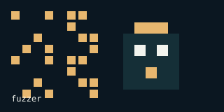

# fuzzer
fuzzer

---

<!-- demo-lab:start -->
## Explore this project

[Project page & walkthrough](https://eforus-overseer.github.io/demo-lab/projects/fuzzer/) — Read an archive walkthrough describing this repository's current state.
<!-- demo-lab:end -->

<!-- codex-pixel-art -->
## Pixel art

A small visual signature for this repository.
